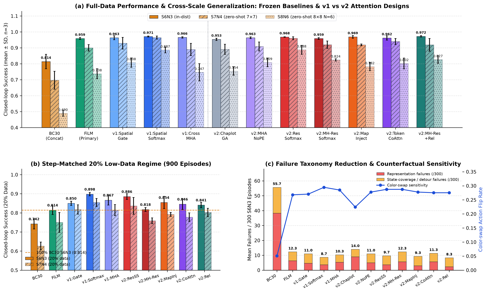
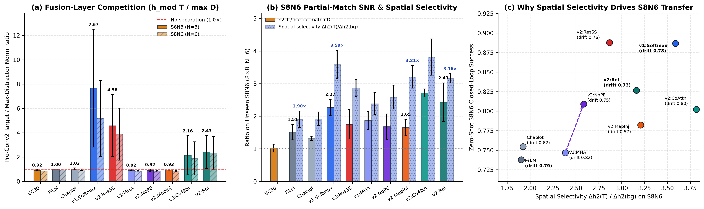
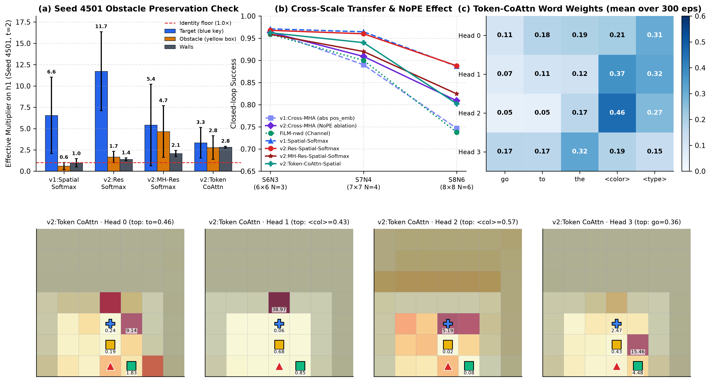

# BabyAI Grounded Language Imitation: Spatial & Relational Attention

[](#)
[](#)
[](#)
[-0E9664)](#repository-branches--archival-structure)

A controlled, mechanistic investigation of **cross-modal fusion inductive biases** for grounded language imitation learning in MiniGrid / BabyAI (`BabyAI-GoToLocalS6N3-v0`), following the AIAA 4220 Project 3 Track 2 protocol (`≤ 5,000` expert episodes, `≤ 30` epochs, `n = 3` initialization seeds, checkpoint strictly selected by `val_action_acc`, closed-loop evaluation on `300` unseen seeds per benchmark, population SD `ddof=0`).

---

## Repository Branches & Archival Structure

| Branch / Tag | Status | Contents |
|---|---|---|
| **`main`** & **`attention-mainline`** | **Active Mainline** | Spatial & Relational Attention mainline: 14 controlled models (`223k–231k` params), 10%–100% step-matched scaling (`reports/b2_attn_v2_scaling.json`), hidden-layer SNR & background-drift probe (`probe_feature_mechanics.py`), verified literature & open-source survey (`branches/b2_attn/LITERATURE_AND_ANALYSIS.md`), and 29-slide SVG-illustrated presentation deck (`presentation/`). |
| **`archive/film-mainline`** & tag **`v1.0-film-archive`** | **Sealed Archive** | Preserved snapshot (`30bcb35`) of the earlier Channel FiLM mainline + FiLM presentation deck. |

---

## Core Scientific Narrative: Why Spatial & Relational Attention Beats Channel FiLM

Rather than treating cross-modal fusion as a black-box accuracy race, this study establishes a **three-stage mechanistic causal chain** across identically controlled `~225k`-parameter networks inserted strictly between `ReLU(Conv1)` and `Conv2`:

1. **Stage 0 → Stage 1 (`BC30 Late Concat` → `Channel FiLM / Chaplot GA`) — Solving Late Linear Binding Failure**
   - In the frozen `BCNet` baseline (`223,071` params), the visual CNN is completely mission-blind (`Δh2 = 0.000` under color swaps). Flattening `7×7×32 → 1,568` before meeting `ℓ ∈ ℝ^32` forces a single linear layer `Linear(1604 → 128)` to approximate multiplicative `(color ∧ type)` conjunctions, yielding color-swap sensitivity `0.051` and `38.3 / 300` representation failures (`S6N3 = 0.814`, `S8N6 = 0.490`).
   - Early channel conditioning (`FiLM`: `H' = (1 + Δγ(ℓ)) ⊙ H + Δβ(ℓ)`) injects multiplicative attribute filtering before `Conv2`, cutting representation failures from `38.3 → 6.3` (`S6N3 = 0.959`).

2. **Stage 1 → Stage 2 (`Channel FiLM` → `Spatial-Softmax Attention` at *Identical* `225,183` Params) — Why Cross-Cell Competition Wins**
   - **Mathematical Contrast**: FiLM broadcasts the *exact same* `(Δγ, Δβ)` to all 49 grid cells with **zero inter-cell competition**, whereas Spatial-Softmax (`α = softmax_49(⟨W_q ℓ, W_k H⟩ / √C)`, `H' = (49·α) ⊙ H`) introduces a global 49-cell partition function where a conjunctive `(color ∧ type)` target suppresses partial-match distractors exponentially by `exp(Δs)`.
   - **Direct Feature-Space Proof (`150` visible-target scenes × `3` seeds, `probe_feature_mechanics.py`)**:
     - Immediately post-fusion (`h_mod`), FiLM's Target / Max-Distractor L2 norm ratio is only **`1.005` (`S6N3`)** and drops below parity to **`0.939` (`S8N6`)** (Chaplot GA: `1.029 / 0.957`), while additive `Δβ` leaks high background drift (**`0.787`** on `S8N6`, spatial selectivity only **`1.90×`**). As distractor count grows (`N = 3 → 4 → 6`), un-suppressed distractor energy accumulates as `O(N-1)`, dragging FiLM down from `0.959 → 0.900 → 0.738` and failing crowded `seed 4502` (`0/3`).
     - At the **exact same `225,183` parameters**, `Spatial-Softmax` raises `h_mod T/max(D)` to **`7.669×` (`S6N3`) / `5.193×` (`S8N6`)** and spatial selectivity to **`3.59×`**, lifting zero-shot `S7N4` to **`0.964` (`+6.4%`)**, `S8N6` to **`0.887` (`+14.9%`)**, solving `seed 4502` (`3/3`), and hitting **`0.802` (`10%`)**, **`0.898` (`20%`**, beating `100%`-data `BC30` `0.814` by `+8.4%`), and **`0.958` (`50%`**, matching `100%`-data `FiLM` `0.959` at half the data!) on step-matched data.

3. **Stage 2 → Stage 3 (`v2 Attention Improvements`) — Three Verified Attention Design Laws**
   - **Law 1 · Translation Equivariance (`NoPE` beats absolute `pos_emb`)**: Standard `Cross-MHA` uses learned `(1, 49, 32)` `pos_emb`, producing the worst `S8N6` background drift (`0.823`) and dropping to `0.747`. Removing `pos_emb` alone (`cross_mha_nopos`) cuts drift to `0.749` and lifts `S8N6` by **`+6.2%` (`0.747 → 0.809`)**.
   - **Law 2 · Decoupled Geometry Preservation (`Attn-Map-Inject`)**: Pure multiplicative `Spatial-Softmax` suppresses blocking obstacles on `seed 4501` down to `0.60×` (seed 2: `0.16×`), dropping `4501` detours to `1/3`. Keeping `h1` unmodified (`1.0×`) and concatenating 4 spatial softmax maps directly into `Conv2(36→32)` achieves the **lowest background drift (`0.568 / 0.569`)** and solves `4501` **`3/3` in optimal `8/8/8` steps** (`S6N3 = 0.969`).
   - **Law 3 · Egocentric Relational Message Passing (`MH-Spatial-Relational`)**: Stacking `49×49` multi-head self-attention with smooth normalized 2D coordinates (`Linear(2, 32)` on `[-1, 1]^2`, inspired by Zambaldi et al. ICLR 2019) onto 4-head residual spatial softmax achieves the **highest `S6N3` (`0.972 ± 0.004`)**, **highest `S8N6` partial-match SNR (`2.430`)**, **lowest total failures (`8.3/300`) and representation failures (`2.3/300`, `attribute_confusion = 1.0`)**, and solves **both `4501` (`3/3`) and `4502` (`3/3`)**.
   - **Honest Tradeoff & Hard Limit**: Single-head `Spatial-Softmax` / `Res-Spatial-Softmax` match `GoToLocal`'s single-target retrieval structure with minimal degrees of freedom (best OOD `S8N6 = 0.888`, best `20%` data `0.898`), whereas `MH-Spatial-Relational` excels at in-distribution precision (`0.972`) and blocked detours (`3/3`). Meanwhile, all single-frame policies fail out-of-view blind-spot `seed 4568` (`0/3`), marking the partial-observability boundary where memory or DAgger is required.

---

## Master Benchmark Results (`mean ± SD`, `ddof=0`, `n = 3` seeds × `300` unseen episodes)

| Method | Family | Params | `S6N3` (6×6) | `S7N4` (7×7 OOD) | `S8N6` (8×8 OOD) | `20%` Data S6 / S7 | Fails /300 (`Repr+Cov`) | `4501` / `4502` |
|---|---|---:|---:|---:|---:|---:|---:|---:|
| `bc30` | Late Concat (control) | 223,071 | 0.814 ± 0.045 | 0.697 ± 0.056 | 0.490 ± 0.019 | 0.742 / 0.627 | 55.7 (`38.3+17.3`) | 1/3 · 0/3 |
| `film_nwd` | Channel FiLM | 225,183 | 0.959 ± 0.006 | 0.900 ± 0.021 | 0.738 ± 0.031 | 0.814 / 0.750 | 12.3 (`6.3+6.0`) | 2/3 · 0/3 |
| `gated_attn_chaplot` | Channel Sigmoid Gate (AAAI 18) | 224,127 | 0.953 ± 0.007 | 0.891 ± 0.032 | 0.754 ± 0.026 | — | 14.0 (`9.0+5.0`) | **3/3** · 0/3 |
| `spatial_attn_gate` (v1) | Unnormalized Spatial Gate | 225,184 | 0.963 ± 0.012 | 0.929 ± 0.037 | 0.808 ± 0.029 | 0.850 / 0.818 | 11.0 (`4.7+6.3`) | 1/3 · **3/3** |
| **`spatial_softmax_attn` (v1)** | **Competitive Spatial Softmax** | **225,183** | **0.971 ± 0.003** | **0.964 ± 0.010** | **0.887 ± 0.018** | **0.898 / 0.854** | 8.7 (`3.7+5.0`) | 1/3 · **3/3** |
| `cross_attn_mha` (v1) | Grid→Token MHA (abs `pos_emb`) | 228,928 | 0.966 ± 0.004 | 0.890 ± 0.039 | 0.747 ± 0.054 | 0.867 / 0.814 | 10.3 (`5.3+5.0`) | **3/3** · 2/3 |
| `cross_mha_nopos` (v2) | Grid→Token MHA (`NoPE`) | 227,360 | 0.963 ± 0.005 | 0.909 ± 0.028 | 0.809 ± 0.027 | — | 11.0 (`5.0+6.0`) | 1/3 · **3/3** |
| `film_spatial_attn` (v1) | Serial FiLM → Spatial Gate | 227,296 | 0.959 ± 0.006 | 0.939 ± 0.023 | 0.788 ± 0.043 | 0.848 / 0.756 | 12.3 (`6.0+6.3`) | 1/3 · 1/3 |
| `film_cross_mha` (v1) | Serial FiLM → Cross-MHA | 231,040 | 0.963 ± 0.003 | 0.926 ± 0.008 | 0.794 ± 0.021 | — | 11.0 (`4.3+6.7`) | 1/3 · 1/3 |
| **`res_spatial_softmax` (v2)** | **Residual Spatial Softmax** | **225,184** | 0.968 ± 0.002 | 0.960 ± 0.009 | **0.888 ± 0.028** | **0.886 / 0.837** | 9.7 (`3.7+6.0`) | 0/3 · **3/3** |
| `mh_res_spatial_softmax` (v2) | 4-Head Residual Softmax | 225,187 | 0.959 ± 0.006 | 0.920 ± 0.023 | 0.824 ± 0.007 | 0.818 / 0.759 | 12.3 (`5.7+6.7`) | 0/3 · 2/3 |
| **`attn_map_inject` (v2)** | **Uncorrupted Map Concat `[h1; M]`** | **226,335** | **0.969 ± 0.008** | 0.919 ± 0.006 | 0.782 ± 0.026 | 0.854 / 0.792 | 9.3 (`3.0+6.3`) | **3/3** · 2/3 |
| `token_coattn_spatial` (v2) | Word-Grid Spatial Co-Attention | 227,435 | 0.962 ± 0.013 | 0.940 ± 0.019 | 0.802 ± 0.034 | 0.846 / 0.778 | 11.3 (`5.7+5.7`) | 2/3 · **3/3** |
| **`mh_spatial_relational` (v2)** | **MH-Res + Ego Relational Attn** | **229,572** | **0.972 ± 0.004** | 0.919 ± 0.040 | 0.827 ± 0.024 | 0.841 / 0.802 | **8.3 (`2.3+6.0`)** | **3/3** · **3/3** |

---

## Visual Mechanistic Evidence

### 1. Full v1 + v2 Attention Benchmark (3 Scales, 20% Low-Data, Failure Taxonomy)


### 2. Feature-Space Proof: Hidden SNR, Spatial Selectivity & Background Drift (`150` Scenes × `3` Seeds)


### 3. Diagnostic Mechanisms: `seed 4501` Obstacle Check, `NoPE` Scale Curve & `Token-CoAttn` Emergent Heads


---

## Key Repository Layout

```text
p3-babyai/
├── src/                                # Frozen baseline (BCNet, BabyAIBot data gen, eval_closed_loop.py)
├── branches/
│   ├── b2_film/                        # B2 Channel FiLM (archived mainline reference & counterfactual probe)
│   ├── b2_attn/                        # Core Attention v1 + v2 mechanistic suite
│   │   ├── attn_net.py                 # v1: Spatial-Gate, Spatial-Softmax, Cross-MHA, FiLM+Spatial, FiLM+MHA
│   │   ├── attn_v2_net.py              # v2: Chaplot GA, NoPE, Res-SS, MH-Res-SS, Map-Inject, Token-CoAttn, MH-Rel
│   │   ├── train_attn.py / train_attn_v2.py
│   │   ├── run_train_all.sh / run_train_v2_all.sh
│   │   ├── eval_and_analyze.py / eval_v2_and_analyze.py
│   │   ├── probe_feature_mechanics.py  # Hidden-layer SNR, spatial selectivity & background drift probe
│   │   └── LITERATURE_AND_ANALYSIS.md  # Verified papers, open-source repos & full mechanistic synthesis
│   ├── b1_langenc/                     # Auxiliary: language encoder controls (GRU/Transformer/MLP)
│   ├── b3_dagger/                      # Auxiliary: loop-unsticking DAgger (+6k–8.5k oracle labels)
│   ├── b4_curriculum/                  # Auxiliary: curriculum pacing controls
│   └── b5_data_eff/                    # Auxiliary: step-matched 10/20/50/100% scaling curves
├── presentation/                       # 29-slide (15 core + 13 backup) Attention-centered presentation deck (.pptx, .pdf, script, renders)
├── reports/                            # Machine-readable JSONs & 300-DPI figures (b2_attn_v2_*.json / *.png)
└── runs/                               # Traceable config.json, history.json, vocab.json for every run
```

---

## Reproducing the Attention v1 + v2 Suite

All experiments use deterministic single-threaded CPU execution (`OMP_NUM_THREADS=1`, PyTorch `2.15.0+cpu`, MiniGrid `3.2.0`, Gymnasium `1.4.0`):

```bash
# 1. Generate frozen 5,000-episode expert dataset (leak-free seed split)
OMP_NUM_THREADS=1 env_embodied/bin/python src/collect_expert.py

# 2. Train & evaluate v1 Attention + FiLM+Attention ablations (24 runs)
bash branches/b2_attn/run_train_all.sh
OMP_NUM_THREADS=1 env_embodied/bin/python branches/b2_attn/eval_and_analyze.py

# 3. Train & evaluate v2 Attention improvements + missing 20% low-data runs (39 runs)
bash branches/b2_attn/run_train_v2_all.sh
OMP_NUM_THREADS=1 env_embodied/bin/python branches/b2_attn/eval_v2_and_analyze.py

# 4. Run hidden-layer feature-space SNR, selectivity & background drift probe
OMP_NUM_THREADS=1 env_embodied/bin/python branches/b2_attn/probe_feature_mechanics.py

# 5. Train & evaluate step-matched 10% / 50% Attention scaling curves (12 runs)
bash branches/b2_attn/run_scaling_attn.sh
```

---

## Key Literature & Open-Source References

- **Chevalier-Boisvert et al. (ICLR 2019)**, *BabyAI: First Steps Towards Grounded Language Learning With a Human In the Loop* (`mila-iqia/babyai`, arXiv:`1810.08272`).
- **Perez et al. (AAAI 2018)**, *FiLM: Visual Reasoning with a General Conditioning Layer* (arXiv:`1709.07871`).
- **Chaplot et al. (AAAI 2018)**, *Gated-Attention Architectures for Task-Oriented Language Grounding*.
- **Xu et al. (ICML 2015)**, *Show, Attend and Tell* & **Wang et al. (CVPR 2017 Spotlight)**, *Residual Attention Network*.
- **Mott et al. (NeurIPS 2019)**, *Towards Interpretable Reinforcement Learning Using Attention Augmented Agents*.
- **Zambaldi et al. (ICLR 2019)**, *Deep Reinforcement Learning with Relational Inductive Biases* (*Relational Deep RL*).
- **Liu et al. (NeurIPS 2018)**, *CoordConv*; **Lu et al. (NIPS 2016)**, *Co-Attention*; **Kim et al. (NeurIPS 2018)**, *Bilinear Attention Networks (BAN)*; **Woo et al. (ECCV 2018)**, *CBAM*.
- **Hashemi Dijujin et al. (arXiv:`2501.15270`)**, *Inductive Biases for Zero-shot Systematic Generalization in Language-informed RL*.
- Related MiniGrid/BabyAI open-source repos: `Farama-Foundation/Minigrid`, `caotians1/BabyAIPlusPlus`, `flowersteam/EAGER`, `flowersteam/Grounding_LLMs_with_online_RL`, `uoe-agents/feedback-dt`, `ShengranHu/thought-cloning`, `andreicnica/hrl_attention`, `Pascalson/KGRL`.
