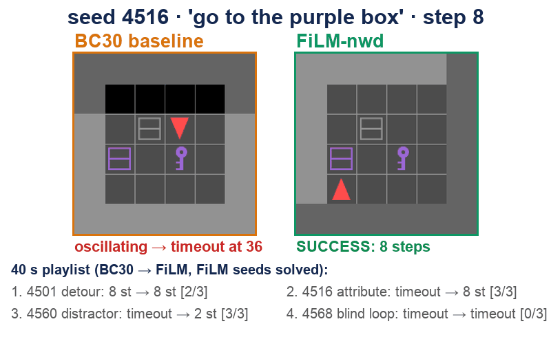
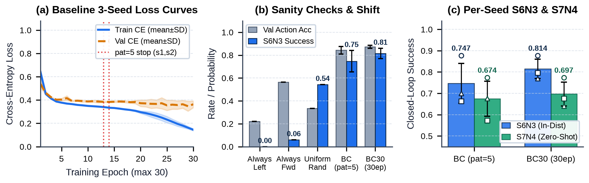
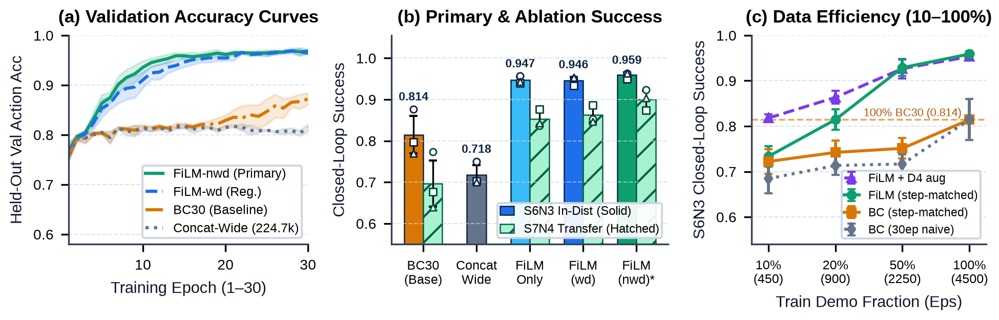
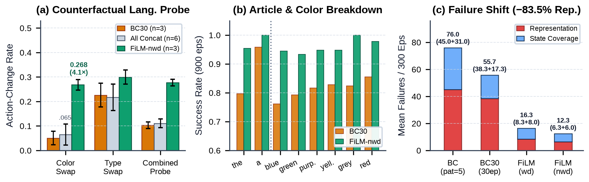
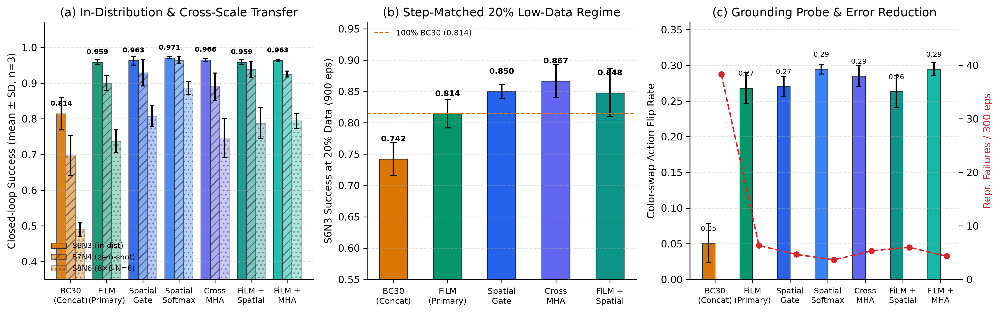
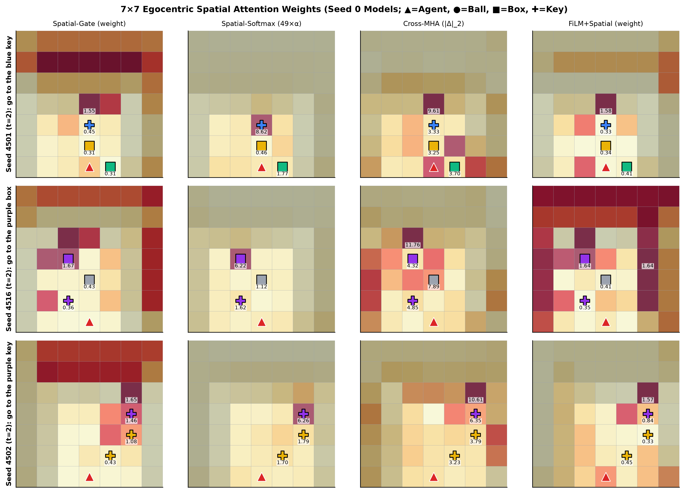

# BabyAI_Exploration_with_Film

**AIAA 4220 Embodied AI · Track 2: BabyAI Grounded Language Imitation (`BabyAI-GoToLocalS6N3-v0`)**

> **Core Finding:** Late vector concatenation in `BCNet` suffers from **color-shortcut collapse**—swapping the color word in a mission changes greedy actions on only **5.1%–6.5%** of counterfactual test states. Inserting a single zero-initialized **Feature-wise Linear Modulation (FiLM)** block after `conv1` (+2,112 parameters, **+0.95%**) raises unseen-seed closed-loop Success from **`0.814 ± 0.045`** (`BC30`; `0.747 ± 0.093` under `patience=5`) to **`0.959 ± 0.006`** (**+0.144**, positive across **3/3** seeds), boosts zero-shot **`S7N4`** transfer from `0.697` to **`0.900 ± 0.021`** (**+0.203**), and matches 100%-data `BC30` using only **20% demonstrations** (`0.814 ± 0.023`). Extending the study with a controlled **`FiLM vs. Attention & FiLM+Attention`** ablation (`branches/b2_attn/`) further reveals that matched-parameter **`Spatial-Softmax`** (`0.971 ± 0.003` S6N3, `0.964 ± 0.010` S7N4, `0.887 ± 0.018` S8N6) resolves crowded multi-distractor cases (`seed 4502`: `0/3 → 3/3`) while trading off obstacle-detour robustness (`seed 4501`: `2/3 → 1/3`).

<p align="center">
  
</p>

---

## 📑 快速导航（Deliverables & Documentation）

| 类别 | 文件 | 说明 |
|---|---|---|
| **汇报幻灯片 (PPTX / PDF)** | [`presentation/AIAA4220_Project3_Presentation.pptx`](presentation/AIAA4220_Project3_Presentation.pptx) · [`.pdf`](presentation/AIAA4220_Project3_Presentation.pdf) | 21 页正式汇报幻灯片（9 页核心 8 分钟演讲 + 12 页备份 `B1–B11`，含内嵌 40.2 秒对比动画） |
| **逐字讲稿与 Q&A 题库** | [`presentation/讲稿与QA准备.md`](presentation/讲稿与QA准备.md) | 三人分工时间轴（A/B/C 共 480 秒）+ 16 道高频技术追问与 JSON 溯源答案 |
| **主修改汇总报告 (B2 FiLM)** | [`reports/b2_film_summary.md`](reports/b2_film_summary.md) | 8 组 FiLM 与等参数对照实验、反事实语言探针与失败拆解 |
| **Attention 与融合消融报告** | [`reports/b2_attn_summary.md`](reports/b2_attn_summary.md) | 24 组 3-seed `FiLM vs. Spatial-Gate / Spatial-Softmax / Cross-MHA / FiLM+Attention` 消融总结 |
| **冻结基线复现报告** | [`reports/baseline_report.md`](reports/baseline_report.md) | 9 节完整基线复现、早停诊断、`always_forward` 健全性核查与协议说明 |
| **个案与轨迹分析** | [`docs/CASE_ANALYSIS.md`](docs/CASE_ANALYSIS.md) | 1 例绕障成功 + 5 例语言接地失败 + 3 例状态覆盖失败及 FiLM 逐例实测 |
| **课程合规与环境档案** | [`docs/HANDBOOK_COMPLIANCE.md`](docs/HANDBOOK_COMPLIANCE.md) · [`docs/environment.md`](docs/environment.md) | 对照项目手册逐条自查、硬件配置、CPU 单线程确定性与 Git Commit 溯源 |
| **AI 使用披露与支线总览** | [`docs/AI_USAGE.md`](docs/AI_USAGE.md) · [`branches/README.md`](branches/README.md) | 生成式 AI 辅助边界与人工核验记录、五条支线隔离契约 |

> 注：本仓库全部 3-seed 统计量 `mean ± SD` 统一采用总体标准差（`ddof=0` / `statistics.pstdev`），与 `reports/*.json` 逐位一致；换算为样本标准差（`ddof=1`）只需乘以 $\sqrt{3/2} \approx 1.225$。

---

## 1. 任务定义与核心病灶（`BabyAI-GoToLocalS6N3-v0`）

### 1.1 POMDP 规范（非 DoorKey，无捡钥匙/开门操作）
* **环境与目标**：`BabyAI-GoToLocalS6N3-v0`（6×6 单房间、内部 4×4 可通行网格，无内墙与门）随机放置 **3 个物体**（1 个目标 + 2 个干扰物），取自 6 种颜色（`red, green, blue, purple, yellow, grey`）与 3 类形状（`ball, box, key`）。
* **多模态输入**：
  1. **局部视野** $I_t \in \{0..10\}^{7\times 7\times 3}$：自我中心 7×7 符号网格，3 个通道分别编码 `(OBJECT_IDX, COLOR_IDX, STATE_IDX)`（看不到背后，障碍物前后方均有遮挡）；
  2. **语言指令** $m$：固定 14 词词表编码的 5 词模板 `go to <the|a> <color> <type>`（`the` 表示唯一匹配目标，`a` 表示场景存在多个匹配物体）；
  3. **离散朝向** $d_t \in \{0,1,2,3\}$：东南西北 4 维 one-hot（必要状态：13,263 个唯一图像对应 14,374 个唯一 `(image, direction)` 状态）。
* **动作、终止条件与回报**：动作空间共 7 维（`left, right, forward, pickup, drop, toggle, done`），但 `GoToLocal` 专家数据中**只使用前 3 个导航动作**（`forward` 56.4%、`left` 22.0%、`right` 21.5%，其余 4 个动作占 **0.0%**）。当智能体在 $H=36$ 步内站到目标正交相邻格且**正面朝向目标**时环境判定成功（`terminated=True`），回报为 $R = 1 - 0.9(t/H)$；超时则 `truncated=True, R=0`。
* **评估方式**：主指标为在 **300 个未见测试种子（`4500..4799`）** 上的无 teacher forcing **闭环成功率（Closed-loop Success）**；零样本跨房间迁移于 `BabyAI-GoToLocalS7N4-v0`（7×7、4 物体、$H=49$，种子 `10000..10299`）与 `BabyAI-GoToLocalS8N6-v0`（8×8、6 物体、$H=64$，种子 `10000..10299`）上评估。

### 1.2 我们诊断出的两大核心现象
1. **教师强制动作准确率 $\neq$ 闭环任务成功率**：平凡基线 `always_forward` 在验证集上的动作准确率高达 **56.4%**，但闭环成功率仅 **0.060**；基线 `BC30` 动作准确率 **0.873** 而闭环成功率 **0.814**，且**全部失败局都跑满 36 步超时**（一阶决策失误把智能体带入专家未访问状态，发生协变量偏移死锁）。
2. **晚期拼接引发“颜色捷径坍缩（Color-Shortcut Collapse）”**：基线 `BCNet` 把视觉与语言拖到最后全连接层才线性拼接，导致网络几乎不读取指令颜色词——反事实把指令换成场景里另一个真实存在的颜色物体时，**`BC30` 仅 5.1% 的状态会改变动作（所有拼接变体平均 6.5%）**，在同色干扰物/近处干扰物前极易发生属性混淆与干扰物优先错误。

---

## 2. 方法架构：早期 FiLM 跨模态融合与 Attention 消融变体

### 2.1 基线 `BCNet` vs. 唯一主修改 `FiLMBCNet`（`branches/b2_film/film_net.py`）
* **基线 `BCNet`（223,071 参数）**：类别图像经三通道共享查表 `nn.Embedding(11, 8)` 形成 $24 \times 7 \times 7$ 特征图 $\rightarrow$ 两层无池化 `Conv2d(·, 32, 3×3, pad=1) + ReLU` $\rightarrow$ 展平为 $v \in \mathbb{R}^{1568}$；指令经掩码平均词嵌入得到 $\ell \in \mathbb{R}^{32}$；与 4 维朝向 $u$ 晚期拼接 $[v; \ell; u] \in \mathbb{R}^{1604}$ 送入 `Linear(1604, 128) → ReLU → Linear(128, 7)`。
* **主修改 `FiLMBCNet`（225,183 参数，仅 +2,112 / +0.95%）**：保持数据、编码器、卷积核、全连接头、30 轮优化器与 `val_action_acc` 选模规则**完全不变**，仅在 `conv1` 激活输出 $H^{(1)} \in \mathbb{R}^{32\times 7\times 7}$ 与 `conv2` 之间插入一层**零初始化单层线性 FiLM 生成器**（$W_{\text{FiLM}}=0, b_{\text{FiLM}}=0$）：
  $$[\Delta\gamma; \Delta\beta] = W_{\text{FiLM}}\ell + b_{\text{FiLM}} \in \mathbb{R}^{64}, \qquad H'^{(1)}_{c,i,j} = (1 + \Delta\gamma_c)\cdot H^{(1)}_{c,i,j} + \Delta\beta_c$$
  训练第 0 步时严格恒等起步（不破坏早期梯度）；训练过程中语言向量在 `conv2` 混合相邻格子之前直接对 32 个视觉通道做**逐通道乘性放大与抑制**，同时在空间坐标 $(i,j)$ 上均匀保留墙壁与障碍物几何信息。

### 2.2 FiLM vs. Attention 与 `FiLM + Attention` 融合架构（`branches/b2_attn/attn_net.py`）
为严格回答“**为何选 FiLM 而非手册并列的 Attention？两者能否融合？**”，我们在 `ReLU(conv1)` 与 `conv2` 之间实现并对比了 5 个受控模块：
1. **`spatial_attn_gate`（225,184 参数，+2,113）**：空间门控注意力，$q=\text{Linear}(\ell)$, $k=\text{Conv}_{1\times 1}(H^{(1)})$，零初始化标量 $s$ 生成空间权重 $(1 + s \cdot \tanh(q^\top k / \sqrt{C})) \odot H^{(1)}$。
2. **`spatial_softmax_attn`（225,183 参数，+2,112，与 FiLM 参数完全相等）**：经典 49 格竞争归一化空间注意力 $\alpha = \text{softmax}_{i,j}(q^\top k / \sqrt{C})$，输出 $(49\cdot \alpha) \odot H^{(1)}$。
3. **`cross_attn_mha`（228,928 参数，+5,857）**：4 头多头交叉注意力（49 个加了 2D 可学习位置编码的网格 Query $\times$ 5 个指令 Token Key/Value，带 `key_padding_mask` 与零初始化残差尺度）。
4. **`film_spatial_attn`（227,296 参数，+4,225）**：**串联融合 FiLM（通道 *What*）→ Spatial-Gate（空间 *Where*）**，即语言条件化 CBAM。
5. **`film_cross_mha`（231,040 参数，+7,969）**：**串联融合 FiLM（通道）→ 4-head Cross-Attention（空间–词元细粒度对齐）**。

---

## 3. 完整实验结果（3 初始化种子 × 300 未见种子，`mean ± SD`, `ddof=0`）

### 3.1 双基线复现与平凡策略检验

| 模型 / 策略 | 参数量 | 选模协议 | `val_action_acc` | **S6N3 Success** | 平均回报 / 中位步数 / 超时 | **S7N4 零样本** |
|---|---|---|---|---|---|---|
| `always_forward`（平凡） | — | — | `0.564` | `0.060` | `0.058` / `1.0` / `282.0` | — |
| `always_left`（平凡） | — | — | `0.220` | `0.000` | `0.000` / `—` / `300.0` | — |
| `random`（左/右/前均匀随机） | — | — | `≈0.333` | `0.543` | `0.345` / `13.0` / `138.0` | — |
| **原冻结基线** `baseline_seed{0,1,2}` | 223,071 | `patience=5` | `0.843 ± 0.033` | **`0.747 ± 0.093`** | `0.656` / `4.0` / `76.0` | `0.674 ± 0.082` |
| **受控基线 `BC30`** `b3_bc30_seed{0,1,2}` | 223,071 | 满 30 ep | `0.873 ± 0.013` | **`0.814 ± 0.045`** | `0.723` / `4.0` / `55.7` | `0.697 ± 0.056` |

> 审计发现：`patience=5` 在验证集平台期过早掐断 seed 1（ep 13）与 seed 2（ep 14），人为低估基线；保持相同 `val_action_acc` 选模规则跑满 30 epoch 得到 `BC30`（`0.814 ± 0.045`），作为全部改进的保守无混淆主对照。

<p align="center">
  
</p>

### 3.2 主修改结果：B2 FiLM 与容量/正则/探针验证

| 组别 | 参数量 | 正则配置 | `val_acc` | **S6N3 Success** (s0 / s1 / s2) | Δ vs `BC30` | 回报 / 中位步 / 超时 | **S7N4 零样本** |
|---|---|---|---|---|---|---|---|
| `BC30`（主对照） | 223,071 | `wd=0` | `0.873 ± 0.013` | `0.814 ± 0.045` (.877/.797/.770) | — | `0.723` / `4.0` / `55.7` | `0.697 ± 0.056` |
| `concat_nwd`（同代码复刻） | 223,071 | `wd=0` | `0.881 ± 0.009` | `0.836 ± 0.015` (.853/.837/.817) | `+0.021` (2/3+) | `0.740` / `4.0` / `49.3` | `0.776 ± 0.026` |
| `concat_wd` | 223,071 | `wd=1e-4` | `0.825 ± 0.003` | `0.707 ± 0.027` (.697/.743/.680) | `−0.108` (0/3+) | `0.617` / `4.0` / `88.0` | — |
| `concat_wide_wd`（等参对照） | 224,683 | `wd=1e-4` | `0.822 ± 0.001` | **`0.718 ± 0.023`** (.750/.703/.700) | `−0.097` (0/3+) | `0.625` / `4.3` / `84.7` | — |
| **`film_nwd`（★ 主修改）** | **225,183** | `wd=0, λ=0` | **`0.972 ± 0.004`** | **`0.959 ± 0.006`** (.963/.950/.963) | **`+0.144` (3/3+)** | **`0.871` / `3.0` / `12.3`** | **`0.900 ± 0.021` (+0.203)** |
| `film_wd` | 225,183 | `wd=1e-4, λ=1e-3` | `0.971 ± 0.005` | `0.946 ± 0.009` (.950/.933/.953) | `+0.131` (3/3+) | `0.858` / `3.0` / `16.3` | `0.862 ± 0.017` |
| `film_only_wd`（去拼接） | **221,087** | `wd=1e-4, λ=1e-3` | `0.963 ± 0.005` | `0.947 ± 0.007` (.957/.940/.943) | `+0.132` (3/3+) | `0.860` / `3.0` / `16.0` | `0.852 ± 0.017` |
| `film_res_wd`（+残差） | 225,183 | `wd=1e-4, λ=1e-3` | `0.950 ± 0.006` | `0.938 ± 0.014` (.953/.920/.940) | `+0.123` (3/3+) | `0.848` / `3.0` / `18.7` | — |

* **排除参数容量混淆**：等参数 `concat_wide_wd`（224,683 参数）比同正则 `film_wd` 低 **−0.228**；去掉末端拼接、总参数比基线还少 1,984 的 `film_only_wd`（221,087 参数）仍达 **0.947**。
* **反事实探针与失败迁移**：183 个可切换测试状态上，`FiLM-nwd` 将换色敏感度由 Concat 的 `0.065`（`BC30` 单独 `0.051`）拉升至 **`0.268 ± 0.021`（4.1×）**，每 300 局表征类失败由 `38.3` 暴降 **83.5%** 至 **`6.3`**（`attribute_confusion 19.3→4.7`, `distractor_priority 19.0→1.7`），状态覆盖类失败降至 **`6.0`**。

<p align="center">
  
  <br/>
  
</p>

### 3.3 FiLM vs. Attention 与 `FiLM + Attention` 融合受控消融（`branches/b2_attn/`）

> **结论速览：FiLM 与 Attention 可以稳定串联融合，但并不“1 + 1 > 2”。**

| 方法 | 参数量 | `val_acc` | **S6N3 Success** | **S7N4 零样本** | **S8N6 (10000:)** | **20% 数据 S6** | 换色敏感度 | 失败/300 (表征+覆盖) | `4501`(绕障) | `4502`(拥挤紫匙) |
|---|---|---|---|---|---|---|---|---|---|---|
| `bc30` (Concat) | 223,071 | `0.873 ± 0.013` | `0.814 ± 0.045` | `0.697 ± 0.056` | `0.490 ± 0.019` | `0.742 ± 0.026` | `0.051 ± 0.027` | `55.7` (38.3+17.3) | 1/3 | 0/3 |
| `film_nwd` (Primary) | 225,183 | `0.972 ± 0.004` | `0.959 ± 0.006` | `0.900 ± 0.021` | `0.738 ± 0.031` | `0.814 ± 0.023` | `0.268 ± 0.021` | `12.3` (6.3+6.0) | **2/3** | 0/3 |
| `spatial_attn_gate` | 225,184 | `0.973 ± 0.009` | `0.963 ± 0.012` | `0.929 ± 0.037` | `0.808 ± 0.029` | `0.850 ± 0.011` | `0.271 ± 0.014` | `11.0` (4.7+6.3) | 1/3 | **3/3** |
| **`spatial_softmax_attn`** | **225,183** | `0.981 ± 0.001` | **`0.971 ± 0.003`** | **`0.964 ± 0.010`** | **`0.887 ± 0.018`** | — | **`0.295 ± 0.007`** | **`8.7` (3.7+5.0)** | 1/3 | **3/3** |
| `cross_attn_mha` | 228,928 | `0.978 ± 0.001` | `0.966 ± 0.004` | `0.890 ± 0.039` | `0.747 ± 0.054` | **`0.867 ± 0.026`** | `0.285 ± 0.015` | `10.3` (5.3+5.0) | **3/3** | 2/3 |
| `film_spatial_attn` (串联) | 227,296 | `0.976 ± 0.008` | `0.959 ± 0.006` | `0.939 ± 0.023` | `0.788 ± 0.043` | `0.848 ± 0.038` | `0.263 ± 0.022` | `12.3` (6.0+6.3) | 1/3 | 1/3 |
| `film_cross_mha` (串联) | 231,040 | `0.982 ± 0.002` | `0.963 ± 0.003` | `0.926 ± 0.008` | `0.794 ± 0.021` | — | `0.295 ± 0.009` | `11.0` (4.3+6.7) | 1/3 | 1/3 |

1. **为什么空间注意力能解决 `seed 4502`，却会伤害 `seed 4501` 绕障？** 从 `7×7` 注意力热力图可以直观看到：`Spatial-Softmax` 在 `seed 4502`（两把黄钥匙夹击紫钥匙）上将高达 **6.26** 的权重精准聚焦在紫钥匙上，实现 **`3/3`** 全部修复（`FiLM` 因全局等权缩放仅 `0/3`），并在 8×8 高干扰房间 `S8N6` 上将成功率推高 **`+0.149`**（`0.738 → 0.887`）；但在 `seed 4501` 上，`Spatial-Softmax` 把 `blue key` 放大到 **8.62** 的同时把挡路的 `yellow box` 压低至 **0.46**，导致部分种子忽视障碍物，通过率从 `FiLM` 的 `2/3`（及 `Cross-MHA` 的 `3/3`）降至 `1/3`。
2. **为什么串联 `FiLM + Attention` 优于纯 `FiLM`、却未超过独立 `Spatial-Softmax`？** `FiLM+Spatial`（`S7N4 0.939`、`20% 0.848`）与 `FiLM+MHA`（`S7N4 0.926`、`S8N6 0.794`）确实提升了 `FiLM` 的跨房间泛化能力；但由于第一级 `FiLM` 先在通道维抑制了非目标特征，减弱了第二级空间门控的网格对比度（热力图显示背景格产生杂散响应），反而略逊于直接在完整 `Conv1` 特征上做竞争归一化的 `Spatial-Softmax`。

<p align="center">
  
  <br/>
  
</p>

### 3.4 规定次指标：数据效率（`B5`）与全部辅助支线结论

| 数据比例 | 基线协议 (`b5_defrac`) | 步数对齐 Concat (`bc_step`, S6/S7) | **步数对齐 FiLM (`film_step`, S6/S7)** | `FiLM + D4 + TTA` (`film_d4_tta`, S6) |
|---|---|---|---|---|
| **10%** (450 ep) | — | `0.722 ± 0.027` / `0.564 ± 0.033` | `0.733 ± 0.022` / `0.633 ± 0.064` | **`0.828 ± 0.008`（10× 压缩超 `BC30`）** |
| **20%** (900 ep) | `0.732 ± 0.007` | `0.742 ± 0.026` / `0.627 ± 0.021` | **`0.814 ± 0.023` / `0.750 ± 0.052`（5× 追平 `BC30`）** | `0.870 ± 0.014` |
| **50%** (2,250 ep) | `0.747 ± 0.012` | `0.751 ± 0.023` / `0.634 ± 0.006` | **`0.929 ± 0.018` / `0.873 ± 0.011`** | — |
| **100%** (4,500 ep) | `0.814 ± 0.045` | `0.814 ± 0.045` / `0.697 ± 0.056` | **`0.959 ± 0.006` / `0.900 ± 0.021`** | — |

| 支线 | 定位 | 核心发现与与主修改的科学关系 | 汇总 |
|---|---|---|---|
| **B1 · 语言编码器** | 编码器消融 | `Concat + gru_small` 最优（`0.868 ± 0.013` / S7N4 `0.803`），但换色敏感度仅 `0.058`；`FiLM+GRU` 词序打乱暴跌 `-0.151`～`-0.342` | [`b1_langenc_summary.md`](reports/b1_langenc_summary.md) |
| **B2 · FiLM 融合** | **★ 唯一主修改** | 零额外样本，`0.814 → 0.959`（`+0.144`, 3/3+），S7N4 `0.900`（`+0.203`），颜色敏感度 `4.1×`，表征失败 `−83.5%` | [`b2_film_summary.md`](reports/b2_film_summary.md) |
| **B2b · Attention/融合** | 跨模态机制对照 | `Spatial-Softmax` 达 `0.971` / S7N4 `0.964` / S8N6 `0.887` 且 3/3 修复 `4502`，但 `4501` 绕障降至 `1/3`；验证串联融合利弊 | [`b2_attn_summary.md`](reports/b2_attn_summary.md) |
| **B3 · DAgger-lite** | 交互纠偏（正交下一步） | 定位 `patience=5` 误早停；两轮解卡达 `0.909 ± 0.019`；**叠加 `FiLM + DAgger` 达 `0.970 ± 0.007`**（彻底消除 `4568` 盲区振荡） | [`b3_dagger_summary.md`](reports/b3_dagger_summary.md) |
| **B4 · 课程学习** | 排序与多尺度泛化 | 同域 `pace_easy` `0.857` 优于 `pace_hard` `0.818`；`FiLM` + 多尺度房间将未见 **S7N4 推至 `0.924`**、**S8N6 推至 `0.844`** | [`b4_curriculum_summary.md`](reports/b4_curriculum_summary.md) |
| **B5 · 数据效率** | 规定次指标与 D4 增广 | 步数对齐 3,900 步；证明任意增广下 Concat <100% 均难追平 `BC30`，FiLM 实现 5×–10× 压缩 | [`b5_data_eff_summary.md`](reports/b5_data_eff_summary.md) |

---

## 4. 实验协议与硬件可复现性

### 4.1 严格无泄漏 5,000 条专家种子划分（`src/common.py`）
指导文档原示例写 `range(0, 4000)` 生成 5,000 条，因单一确定性环境种子只产 1 条轨迹，且按 `val_action_acc` 选模需保留 500 条验证专家轨迹，我们在 `src/common.py` 中用互不相交的补足段满足两项硬约束（并由 `assert_no_leak()` 在入口硬断言）：
* **训练集（4,500 条 / 16,534 转移）**：`[0:4000] ∪ [4800:5300]`
* **验证集（500 条 / 1,844 转移）**：`[4000:4500]`（**总计 4,500 + 500 = 5,000 条，未超预算上限**）
* **未见同分布测试集（S6N3，300 条）**：`[4500:4800]`
* **未见跨尺寸零样本迁移（S7N4 / S8N6，各 300 条）**：`[10000:10300]`

### 4.2 锁死环境与运行命令
* **软硬件**：Dual AMD EPYC 7453 (503 GiB RAM) · `Python 3.12.14` · `torch==2.15.0+cpu` · `minigrid==3.2.0` · `gymnasium==1.4.0` · `numpy==2.5.4`（详见 [`requirements-lock.txt`](requirements-lock.txt) 与 [`docs/environment.md`](docs/environment.md)）。
* **确定性铁律**：全程单线程 CPU（`OMP_NUM_THREADS=1` + `torch.set_num_threads(1)`），同 seed 重训得到的 `best_model.pt` 逐字节一致（单模型训练 ~55–70 秒）。

```bash
# 1. 环境安装（uv）
curl -LsSf https://astral.sh/uv/install.sh | sh && source $HOME/.local/bin/env
uv venv env_embodied --python 3.12 && source env_embodied/bin/activate
uv pip install -r requirements-lock.txt
export SDL_VIDEODRIVER=dummy SDL_AUDIODRIVER=dummy

# 2. 基线复现（生成 5,000 条专家数据 + 3-seed 基线 + 评估与归因，~2 分钟）
bash run_baseline.sh

# 3. 主修改 B2 FiLM 一键复现 / 只读核验
bash run_film_main.sh --eval-only   # 秒级核验已存盘结果与冻结区完整性
bash run_film_main.sh               # 从头训练全部 8 组 B2 变体 × 3 seed + 探针 + 评估（~12 分钟）

# 4. FiLM vs Attention & FiLM+Attention 融合消融（24 组训练 + 全量评估与热力图）
bash branches/b2_attn/run_train_all.sh
OMP_NUM_THREADS=1 python branches/b2_attn/eval_and_analyze.py

# 5. 其余辅助支线与本地 PPT 重建
bash branches/b5_data_eff/run.sh    # B5 数据效率
bash branches/b1_langenc/run.sh     # B1 语言编码器
bash branches/b3_dagger/run.sh && bash branches/b3_dagger/run_v2.sh  # B3 DAgger-lite
bash branches/b4_curriculum/run.sh  # B4 课程学习
cd presentation && zsh make_all.sh  # macOS 下重建 PPTX、PowerPoint 导出 PDF、渲染 21 页 PNG 并校验数值
```

---

## 5. 仓库结构与参考文献

```text
BabyAI_Exploration_with_Film/
├── README.md                  # 本总览文档
├── requirements-lock.txt      # 36 个依赖包精确版本锁
├── run_baseline.sh            # 一键基线复现脚本
├── run_film_main.sh           # ★ 主修改 B2 FiLM 复现与只读核验入口
├── src/                       # ★ 冻结核心模块（common.py, train_bc.py, eval_closed_loop.py 等）
├── branches/
│   ├── README.md              # 支线隔离契约与完成总览
│   ├── _shared/               # 支线共用工具与归档接地失败案例
│   ├── b2_film/               # ★ 主修改：FiLMBCNet、反事实探针与失败对比
│   ├── b2_attn/               # ★ FiLM vs Attention 与 FiLM+Attention 融合消融（24 runs）
│   └── b{1,3,4,5}_*/          # 其余四条已完成支线（语言编码器 / DAgger / 课程学习 / 数据效率）
├── docs/                      # HANDBOOK_COMPLIANCE.md, CASE_ANALYSIS.md, environment.md, AI_USAGE.md, SUBMISSION.md
├── runs/                      # 各支线 config.json / history.json / vocab.json 与已追踪核心权重
├── reports/                   # 全部原始 JSON/CSV 评估文件、汇总 Markdown 与出版级图表
├── videos/                    # 轨迹 GIF 与 49s 演示视频
└── presentation/              # ★ 21 页汇报 PPTX/PDF、40.2s 对比动图、渲染图与中文逐字稿/QA
```

**参考文献与致谢**：
1. Chevalier-Boisvert et al., *BabyAI: A platform to study the sample efficiency of grounded language learning*, ICLR 2019.
2. Hui et al., *BabyAI 1.1*, arXiv:2007.12770, 2020.
3. Perez, Strub, de Vries, Dumoulin, Courville, *FiLM: Visual reasoning with a general conditioning layer*, AAAI 2018.
4. Perez, *FiLM: A retrospective*, ML Retrospectives @ NeurIPS 2019.
5. Farama Foundation, *MiniGrid & BabyAI v3.2.0* (`GoToLocal`, `BabyAIBot`).
6. Ross, Gordon, Bagnell, *A reduction of imitation learning and structured prediction to no-regret online learning (DAgger)*, AISTATS 2011.
7. Towers et al., *Gymnasium v1.4.0*, arXiv:2407.17032, 2024.

**生成式 AI 使用说明（手册 §7）**：本项目使用 Claude / Gemini IDE 助手辅助代码脚手架、评估/作图脚本与演示文稿排版润色；所有模型训练、闭环评测、反事实探针与失败归因均在远程 EPYC 服务器以单线程确定性运行生成，全部数值可直接追溯至 `reports/*.json`（详见 [`docs/AI_USAGE.md`](docs/AI_USAGE.md)）。
