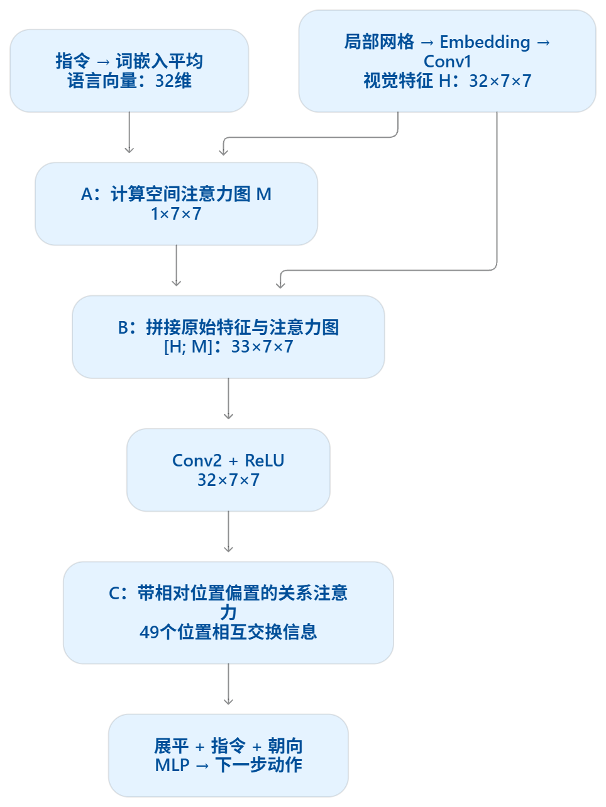

如果你是 Agent 不要修改这个文件。

为了解决语言维度过小的问题，我们提出了一个注意力架构。

首先输入指令和局部视野空间。

**模块 A**：计算 指令 和 空间 的 交叉注意力。输出 1x7x7 

**模块 B**：将模块 A 的注意力和原始特征拼起来，也就是 concat。模块A 1x7x7 + 空间特征 32x7x7 -> 33x7x7

**Conv2 + ReLU 模块**：就是计算卷积，他会把 33 个通道用 32 个卷积核 融合成 32 个通道。33x7x7 -> 32x7x7。

**模块 C**：计算空间每一个格子的自注意力 32x7x7。也就是 49 个格子做自注意力。

32x7x7 -> 49x32 -> (做自注意力) 49x32 -> (展开) 32x7x7

最后就是 flatten 和 MLP。

---

1. experiment result: 省流：比原主线好

| 阶梯 / 模型                                                   |            参数量 |     `val_acc` |            `S6N3` (ID) |           `S7N4` (OOD) |     `S8N6` (OOD) |         `20%` S6 / S7 |  失败数/300 (`表征+覆盖`) | `4501` / `4502` / `4568` |
| ------------------------------------------------------------- | ----------------: | --------------: | -----------------------: | -----------------------: | -----------------: | ----------------------: | --------------------------: | -----------------------------: |
| `0. BC30` (晚期拼接)                                        |           223,071 |           0.873 |           0.814 ± 0.045 |           0.697 ± 0.056 |     0.490 ± 0.019 |           0.742 / 0.627 |        55.7 (`38.3+17.3`) |              1/3 · 0/3 · 0/3 |
| `0'. Channel FiLM`                                          |           225,183 |           0.972 |           0.959 ± 0.006 |           0.900 ± 0.021 |     0.738 ± 0.031 |           0.814 / 0.750 |          12.3 (`6.3+6.0`) |              2/3 · 0/3 · 0/3 |
| `1. +A: 1H Spatial-SS`                                      |           225,183 |           0.981 |           0.971 ± 0.003 |           0.964 ± 0.010 |     0.887 ± 0.018 |           0.898 / 0.854 |           8.7 (`3.7+5.0`) |              1/3 · 3/3 · 0/3 |
| **`2. +A+B: 1H Map-Inject`** (`s2_map1h`)           | **225,471** |           0.979 | **0.974 ± 0.004** | **0.960 ± 0.003** |     0.829 ± 0.023 | 0.881 / **0.858** | **7.7 (`2.7+5.0`)** |    **3/3 · 3/3** · 0/3 |
| **`3. +A+B+C: Map1H+RelBias`** (`s3_map1h_relbias`) | **230,436** | **0.983** | **0.974 ± 0.002** |           0.944 ± 0.009 |     0.814 ± 0.009 |           0.876 / 0.802 | **7.7 (`1.7+6.0`)** |    2/3 · **3/3** · 0/3 |
| `3'. +A+B'+C: Res1H+RelBias` (`s3_res1h_relbias`)         |           230,149 |           0.982 |           0.970 ± 0.005 |           0.953 ± 0.007 |     0.841 ± 0.046 |           0.883 / 0.821 |           9.0 (`3.0+6.0`) |              1/3 · 2/3 · 0/3 |
| *ref: v2 4H MH-Rel (旧主线)*                                |       *229,572* |       *0.982* |       *0.972 ± 0.004* |       *0.919 ± 0.040* | *0.827 ± 0.024* |       *0.841 / 0.802* |       *8.3 (`2.3+6.0`)* |          *3/3 · 3/3 · 0/3* |

（这个 B' 就是残差调制 $(H+\lambda M\odot H)$ 生成 32x7x7，结果发现不如直接 concat）

1. 为什么不使多头注意力：实验中单头比多头表现更好。
3. 注意力模块堆叠：我还没试。
